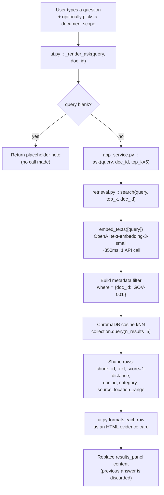

# Ask ContractIQ — How It Works, and the Two Real Flaws

**Status:** analysis only. Nothing in this document has been changed in code yet.
**Date:** 2026-10-23
**Scope:** the "Ask ContractIQ" tab and everything behind it.

---

## 1. The short version

What you are calling "the chatbot" is, in its current implementation, **a
semantic search box — not a conversational agent**. That distinction is the
root of both flaws you noticed:

| What you observed | What is actually happening |
|---|---|
| "It only returns one thing" | GOV-001 is stored in the index as **exactly one chunk**, so there is literally only one thing to return. Not a search bug — a chunking consequence. |
| "It will not let you type another thing after that" | There is **no conversation state at all**. Every search is independent and overwrites the previous result. There is no history, no follow-up, no "it"/"that" resolution. |

Both are design limitations, not crashes. But both are real, and the second
one is the reason it does not feel like a chatbot.

---

## 2. Files involved

The entire Ask flow touches **4 files**. Everything else in `src/contractiq/`
is used by the risk agents, not by Ask.

| # | File | Function(s) | Responsibility |
|---|---|---|---|
| 1 | `src/contractiq/ui.py` | `build_ask_tab()`, `_render_ask()` | Renders the tab; formats results as HTML cards |
| 2 | `src/contractiq/app_service.py` | `ask()` | Thin facade; guards empty input; passes doc scope through |
| 3 | `src/contractiq/retrieval.py` | `search()`, `embed_texts()`, `get_chroma_collection()` | Embeds the question, queries ChromaDB, shapes results |
| 4 | `src/contractiq/config.py` | `EMBEDDING_MODEL`, `CHUNK_SIZE_WORDS`, `CHUNK_OVERLAP_WORDS` | The settings that *cause* flaw #1 |

Also relevant (indirectly — it created the chunks being searched):

| File | Function | Why it matters here |
|---|---|---|
| `src/contractiq/retrieval.py` | `chunk_document()` | Decides how many chunks a document becomes |
| `src/contractiq/parsing.py` | `parse_docx_document()` | Produced the clauses that were chunked |
| `src/contractiq/api.py` | `POST /api/ask` | The HTTP equivalent of the same flow |

---

## 3. The flow, end to end



### Step-by-step with real code

**Step 1 — UI event binding** (`ui.py`, `build_ask_tab`)

```python
ask_btn.click(fn=_render_ask, inputs=[query_box, doc_filter], outputs=results_panel)
query_box.submit(fn=_render_ask, inputs=[query_box, doc_filter], outputs=results_panel)
```

Note what is **not** here: no `gr.Chatbot`, no `gr.State`, no history list.
`outputs=results_panel` means each run **replaces** the panel.

**Step 2 — facade** (`app_service.py`)

```python
def ask(query: str, doc_id: Optional[str] = None, top_k: int = 5):
    if not query or not query.strip():
        return []
    return search(query, top_k=top_k, doc_id=doc_id or None)
```

Stateless. It receives only the current string. It has no access to anything
you typed before.

**Step 3 — retrieval** (`retrieval.py`)

```python
query_embedding = embed_texts([query])[0]          # 1 OpenAI call
where = {"doc_id": doc_id}                          # metadata filter
results = collection.query(query_embeddings=[query_embedding], n_results=top_k, where=where)
score = round(1 - results["distances"][0][i], 4)    # cosine distance -> similarity
```

**Step 4 — render** (`ui.py`)

Each result becomes one card: `doc_id`, score badge, category,
`source_location_range`, and the first 420 characters of chunk text.

### What this flow deliberately does NOT do

- It does **not** send the retrieved text to an LLM to write an answer.
- It does **not** verify anything (no LLM claim is made, so there is nothing
  to verify).
- It does **not** remember the previous question.

That was an intentional call: returning the real source passages means there
is no generated sentence that could be wrong. But it also means it is not a
chatbot.

---

## 4. Flaw #1 — "it only returns one thing"

### Root cause (measured, not guessed)

`chunk_document()` groups whole clauses until it approaches
`CHUNK_SIZE_WORDS = 700`. A document shorter than that **never splits** — it
becomes a single chunk covering the entire file.

Measured across the real corpus:

```
CHUNK_SIZE_WORDS = 700

doc_id     words  chunks
FIN-004      406       1   <- whole doc = 1 chunk
GOV-001      637       1   <- whole doc = 1 chunk   (the one you tested)
NEG-004      673       1
CMP-006      699       1   <- last single-chunk doc
------------------------------------ 700-word boundary
NEG-006      709       2   <- first doc that splits
MLA-001     1999       4
```

**17 of 36 documents (47%) are a single chunk.** The split boundary lands
exactly on the 700-word setting, which confirms the cause precisely.

### What that produces

Your screenshot: scope = GOV-001 → **1 result**, score **0.148**,
range `paragraph:0-paragraph:46`.

- `n_results=5` was requested; ChromaDB returned 1 because only 1 exists.
- `paragraph:0-paragraph:46` means the card is showing **the entire
  document**, not the part that answers your question.
- The score is low (0.148 vs ~0.33 for a normal hit) because your question's
  signal is diluted across ~637 words of unrelated content — the agreement
  title, parties, purpose, scope, and everything else.

Reproduced directly:

```
--- scoped to GOV-001 ---
  GOV-001  score=0.1649  paragraph:0-paragraph:46     <- 1 result, whole doc

--- scoped to MLA-001 (1999 words, 4 chunks) ---
  MLA-001  score=0.3663  paragraph:12-paragraph:26    <- precise
  MLA-001  score=0.3546  paragraph:24-paragraph:43
  MLA-001  score=0.3375  paragraph:0-paragraph:11
  MLA-001  score=0.3293  paragraph:40-paragraph:46
```

So the tab works correctly on large documents and degrades badly on small
ones. This exact limitation was flagged back in Phase 3 and written down at
the time — it has simply never been fixed:

> *"Small docs (<700 words: billing schedule, pricing table, service report)
> become a single whole-doc chunk — imprecise citations, diluted similarity
> scores. Known limitation, not a bug."*

It was acceptable while Ask was an internal debugging view. It is not
acceptable now that it is a user-facing answer surface.

### A second, smaller contributor

Your query was `"tell me about it_what it is pricing"`. GOV-001 is a
**Post-Project Review** document — it may genuinely contain little or no
pricing content. A good system should be able to say *"this document does not
discuss pricing"*. Right now it cannot say that; it can only return the
closest chunk, however weak, with no threshold.

---

## 5. Flaw #2 — "it will not let you type another thing after that"

### Root cause

There is no conversational state anywhere in the stack:

- `ui.py` uses `gr.Textbox` + `gr.HTML`, **not** `gr.Chatbot` + `gr.State`.
- `outputs=results_panel` **overwrites** the panel on every run.
- `app_service.ask()` takes only `(query, doc_id, top_k)` — no history
  parameter exists.
- The textbox is never cleared, so your previous question stays sitting in
  the input field, which makes it look stuck.

### Consequences

| Expected of a chatbot | Current reality |
|---|---|
| Ask a follow-up ("what about termination?") | Treated as a brand-new unrelated search |
| Use pronouns ("tell me more about **that**") | "that" is embedded literally; it means nothing to the vector search |
| See the conversation so far | Previous Q&A is destroyed on each search |
| Get a written answer | You get raw passages and must read them yourself |

Your phrasing *"tell me about **it**"* is exactly the case that breaks:
`it` has no referent, so it adds noise to the embedding rather than meaning.

### Important: this is not a freeze

I found no code path that disables the textbox. You *can* physically type
again. What is missing is that nothing carries forward — so it feels inert
and unresponsive to follow-ups.

---

## 6. Proposed fixes

Ordered by impact-per-effort. Nothing below is implemented yet.

### Fix A — Make small documents retrievable at clause level *(fixes flaw #1)*

The problem is one setting plus a missing floor. Options:

1. **Lower `CHUNK_SIZE_WORDS`** (e.g. 700 → 300). Simple, but it changes
   chunking for the *entire* corpus and would require re-indexing and
   re-running the Phase 3 retrieval evaluation to prove we did not regress
   the currently-perfect 100% recall@5.
2. **Add a minimum-chunks rule** — if a document produces only one chunk,
   re-chunk it at a smaller target so even a 400-word file yields 2–3
   retrievable units. Targeted; leaves large documents untouched.
3. **Two-stage retrieval** — keep chunks as they are, but after finding the
   best chunk, run a second pass *within* that chunk to pick the most
   relevant paragraphs, and show those instead of the whole document.

**Recommendation: option 3, optionally with 2.** It directly fixes the real
user-visible symptom (being shown a whole document instead of the answer)
without re-indexing the corpus or risking the Phase 3 evaluation result.

**Must do regardless:** re-run `evaluate_retrieval()` after any chunking
change and compare against the saved baseline, exactly as was done for the
hybrid-search experiment. No chunking change ships unmeasured.

### Fix B — Add a relevance floor *(also flaw #1)*

If the best score is below a threshold (~0.25 based on the observed spread
between 0.148 noise and 0.33 real hits), say so plainly:

> *"Nothing in GOV-001 appears to discuss pricing. Closest match scored 0.15,
> which is below the confidence floor."*

Being able to say "not found" is a feature. Right now the system cannot.

### Fix C — Make it an actual conversation *(fixes flaw #2)*

Replace the textbox/HTML pair with a real chat surface:

- `gr.Chatbot` for the visible thread + `gr.State` for history.
- Clear the input box after submit.
- Add **query rewriting**: before embedding, use a cheap LLM call to resolve
  the follow-up against the history — turning *"tell me about it"* into
  *"tell me about pricing in the Post-Project Review agreement"*. This is
  what makes pronouns work, and it is the single highest-value piece.

### Fix D — Optional: generate a grounded answer

Add an LLM step that writes a short answer **from the retrieved passages
only**, and reuse the existing verification machinery in `agents.py`
(`_verify_and_build_finding`) to confirm every quoted claim actually appears
in the retrieved text — the same guarantee the risk agents already give.

This would make it a genuine chatbot without giving up the project's core
rule: **no unverified generated claims**.

---

## 7. Suggested order of work

| Order | Fix | Files touched | Risk |
|---|---|---|---|
| 1 | **B** — relevance floor | `ui.py`, `app_service.py` | Very low; no re-indexing |
| 2 | **C** — chat UI + history + query rewriting | `ui.py`, `app_service.py`, `config.py` | Low; additive |
| 3 | **A** — paragraph-level drill-down | `retrieval.py`, `app_service.py`, `ui.py` | Medium; **must** re-run retrieval eval |
| 4 | **D** — grounded generated answer | `app_service.py`, `agents.py`, `ui.py` | Medium; adds LLM cost per question |

Doing **B + C first** gets you something that behaves like a chatbot within
one pass, without touching the index or risking the Phase 3 numbers.

---

## 8. Honest summary

- Ask ContractIQ was built as a **retrieval viewer**, and as a retrieval
  viewer it works correctly — the single result for GOV-001 is the honest
  output of an index that contains exactly one chunk for that document.
- It was **never built as a conversational agent**, which is why follow-ups
  and pronouns do not work. That is a missing feature, not a broken one.
- The 700-word chunking threshold is the measurable root cause of flaw #1,
  affecting **47% of the corpus**, and it was a known-and-documented
  trade-off from Phase 3 that has outlived its justification.
- Nothing here requires throwing work away. Fixes B and C are additive;
  fix A is a refinement of existing chunking that must be re-measured
  against the existing evaluation set before it ships.
